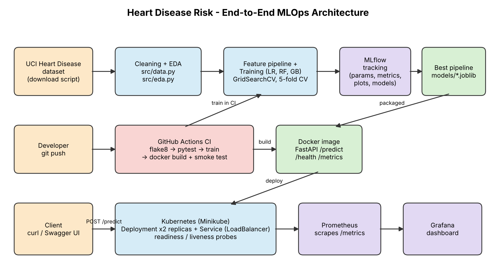

# Heart Disease Risk - End-to-End MLOps Pipeline

Predicts heart disease risk from the UCI Cleveland dataset and ships the model as a
containerised, monitored FastAPI service deployed on Kubernetes (Minikube).



| Stage | Where |
|---|---|
| Data download + cleaning | `scripts/download_data.py`, `src/data.py` |
| EDA | `src/eda.py`, `notebooks/01_eda.ipynb`, `reports/figures/` |
| Features + models | `src/features.py`, `src/modeling.py`, `notebooks/02_training.ipynb` |
| Experiment tracking | `src/train.py` (MLflow, `./mlruns`) |
| Packaged model | `models/best_model.joblib`, `models/mlflow_model/`, `models/model_metadata.json` |
| API | `src/api.py` (`/predict`, `/health`, `/metrics`) |
| Tests | `tests/` (pytest) |
| CI | `.github/workflows/ci.yml` |
| Container | `Dockerfile`, `docker-compose.yml` |
| Kubernetes | `k8s/` and `scripts/deploy_k8s.sh` |
| Monitoring | `monitoring/`, `k8s/monitoring/` (Prometheus + Grafana) |
| Report | `report/build_report.py` -> Word document |

## Quick start (clean machine)
```bash
python -m venv .venv && source .venv/bin/activate
pip install -r requirements-dev.txt
python scripts/download_data.py      # data/raw + data/processed
python -m src.eda                    # figures -> reports/figures
python -m src.train                  # MLflow runs + models/
mlflow ui --backend-store-uri ./mlruns --port 5000
pytest && flake8 src tests scripts
make docker-build && make docker-run # API on http://localhost:8000/docs
bash scripts/smoke_test.sh
bash scripts/deploy_k8s.sh           # Minikube + Prometheus + Grafana
```

## Sample request
```bash
curl -X POST localhost:8000/predict -H 'Content-Type: application/json' -d '{
 "age":63,"sex":1,"cp":4,"trestbps":145,"chol":233,"fbs":1,"restecg":2,
 "thalach":110,"exang":1,"oldpeak":2.8,"slope":2,"ca":2,"thal":7}'
```
Response: `prediction`, `label`, `confidence`, `probability_disease`, `risk_band`, `model_version`.

Full lab-VM instructions: `docs/RUNBOOK.md`. Video script: `docs/VIDEO_SCRIPT.md`.

> Educational project - not a medical device.
